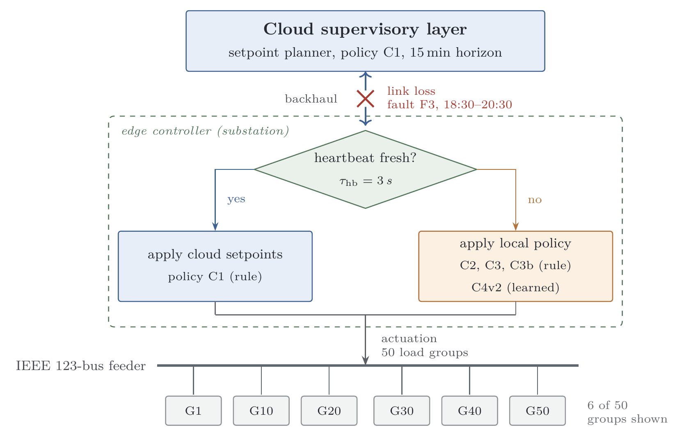
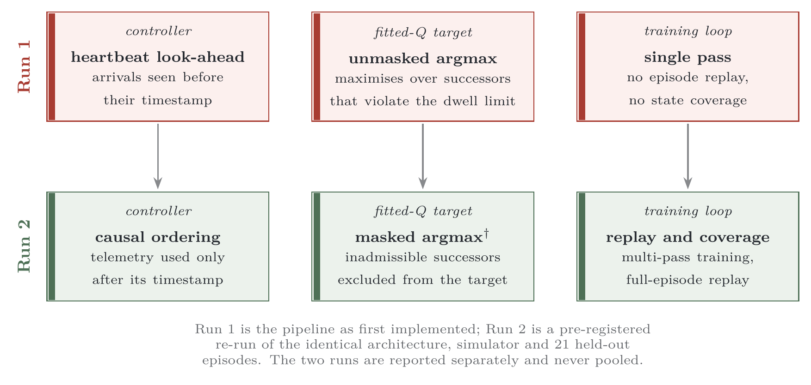

# tikz-paper-figures

A production workflow for schematic figures in academic papers, packaged as a skill for
[WorkBuddy](https://www.workbuddy.cn) / Claude-style agents.

Not an example gallery. A gallery gives you something to copy; this gives you a style contract, a
build check, and a rule about what must not go in the figure.

## What it solves

Drawing one TikZ figure is easy. Drawing nine over four months, in one manuscript, that still look
like siblings — that is where the time goes:

- boxes that do not align because each was placed by hand
- a figure that is 20 cm wide, scaled into a 14 cm column, whose 0.6 pt rules become 0.4 pt and
  whose 7 pt labels become 5 pt
- a colour that meant "fault" in Figure 2 and "alternative" in Figure 6
- a caption that has to explain something the figure should have said itself

The skill fixes the palette, the type scale, the cell geometry, and the export path, and it forces
a compile-render-inspect loop so a regression is caught by looking, not by hoping.

## Quick start

```bash
cp assets/tikz-house-style.tex   your-paper/figures/
cp assets/templates/architecture.tex your-paper/figures/fig_system.tex
python scripts/build_figure.py your-paper/figures/fig_system.tex --target-width 14.8
```

`build_figure.py` compiles, reports the true canvas size, flags overfull boxes, and renders PNG at
300 and 600 dpi. It exits non-zero when the canvas is wider than the target — which is almost
always a text node missing `text width`, the single most common cause of a figure that looks
small when it should look normal.

Requires `pdflatex` plus `pdfinfo`/`pdftoppm` (MiKTeX, TeX Live, or poppler).

## Examples

Both figures below are original work produced with this skill, source in [`examples/`](examples/).



*Layered architecture with a guard, two policy branches, and an actuator rail. 14.1 × 9.1 cm.*



*Before/after stage map: three pipeline defects and their fixes, with the fixed scope in one line.
14.8 × 7.1 cm.*

## Contents

| Path | Purpose |
|---|---|
| `SKILL.md` | the workflow an agent follows |
| `assets/tikz-house-style.tex` | palette, node styles, type scale |
| `assets/templates/` | architecture, before/after map, timeline |
| `references/style-guide.md` | why the rules exist; grayscale and colour-vision checks |
| `references/recipes.md` | which topology fits which figure type |
| `references/pitfalls.md` | LaTeX and TikZ traps with fixes |
| `references/production.md` | export matrix, dpi arithmetic, line-width floor |
| `references/exemplars.md` | external galleries and what to take from each |
| `scripts/build_figure.py` | compile, measure, render, check |

## Relationship to `nature-figure`

They cover different halves of a manuscript and should be used together, not chosen between.

| | `tikz-paper-figures` | `nature-figure` |
|---|---|---|
| Produces | schematics: architecture, pipeline, timeline, mechanism | data plots: bars, intervals, heatmaps, multi-panel evidence figures |
| Toolchain | TikZ, compiled by LaTeX | matplotlib / seaborn, or ggplot2 / patchwork; hand-built SVG for schematics |
| Draws with | LaTeX coordinates and the manuscript's own math font | plotting code, or SVG with live text |
| Strongest check | canvas width against the target column; LaTeX-specific failure modes | PDF geometry: text collisions, panel alignment to 1.5 pt |
| Journal tuning | any width; set it once | Nature-specific: 89 / 183 mm, Arial, 5–7 pt |

Two consequences worth stating plainly:

- **Do not draw data in TikZ.** If the numbers can change, the figure must be regenerated by the
  analysis script. This repository has no plotting support by design.
- **`nature-figure` also has a schematic route, and it draws SVG, not TikZ.** The local install
  contains no reference to TikZ at all. Choose TikZ when the figure needs typeset mathematics,
  automatic box sizing, or `\foreach` repetition that stays in sync with the manuscript font;
  choose SVG when the figure will be finished by hand in Illustrator or Inkscape.

## Why not just use an existing TikZ repository

Repositories such as [PetarV-/TikZ](https://github.com/PetarV-/TikZ) are excellent for seeing what
TikZ can draw, and worth reading for technique. They are collections of finished artefacts, each
tuned to its own canvas. They do not carry a palette that stays meaningful across a manuscript, a
height rule that keeps a row of boxes aligned, a check that the canvas matches the column width, or
an export rule for Word and publisher portals. Those are the parts that decide whether a figure
survives submission, and they are what this repository contains.

## Install as a skill

Copy or link the directory into the skills folder:

```bash
# macOS / Linux
ln -s "$PWD" ~/.workbuddy-ai/skills/tikz-paper-figures

# Windows (Git Bash, elevated)
cmd //c mklink //J "%USERPROFILE%\\.workbuddy-ai\\skills\\tikz-paper-figures" "%CD%"
```

## Licence

MIT. The two examples are original work and may be reused with attribution.
